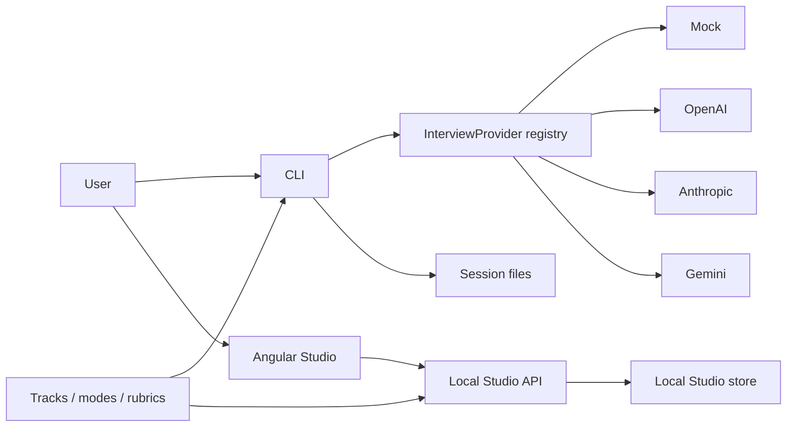

# Architecture Review — InterviewOps

`InterviewOps` is a secondary product proof demonstrating **Angular application architecture, provider abstraction, schema validation, local-first persistence, content-driven extensibility and ethics guardrails**.

## System context

## Architecture strengths

- strict TypeScript and Zod make runtime configuration explicit
- provider registry keeps model-specific code behind a common interface
- Angular standalone components/Signals/RxJS demonstrate modern frontend patterns
- tracks, modes and rubrics are data/content-driven rather than hardcoded into UI components
- local-first storage creates a clear privacy and deployment boundary
- ethics constraints are encoded and tested rather than being only README language

## Failure architecture

- config validation fails early
- provider availability can be checked before a session starts
- mock provider supports deterministic product testing
- output verification checks expected session artifacts
- local-only storage means recovery/backup expectations must be documented rather than implied as cloud durability

## Portfolio role

Keep `InterviewOps` public as supporting engineering depth, but do not position it as a flagship AI architecture platform. Its value is showing disciplined product engineering across Angular, TypeScript, CLI, provider and content boundaries.
