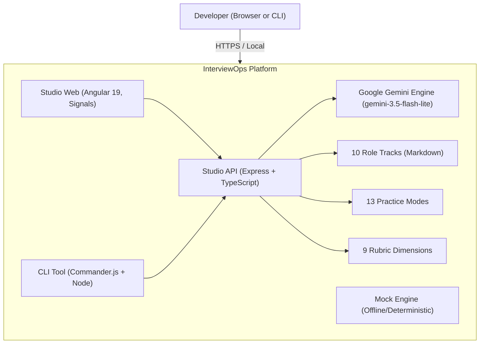

# InterviewOps — Backend Developer AI Mock Interview Platform

> Production-grade AI technical interview simulation and rubric scoring system for Backend, Distributed Systems, and AI Platform Engineers, powered by Google Gemini.

[](https://ashish-ranjan.cloud/interviewOps/)
[](LICENSE)
[](https://nodejs.org)
[](https://ai.google.dev/)
[](https://angular.dev/)

---

## 🌟 Overview

**InterviewOps** is a full-stack, local-first and web-hosted technical mock interview platform tailored specifically for **Senior & Staff Backend Engineers**, **Distributed Systems Architects**, and **AI Platform Engineers**.

It grounds mock interview sessions in real-world high-throughput engineering architectures—evaluating candidates on concurrency controls, event streaming, vector database semantic caching, database indexing, and fault tolerance.

### 🚀 Live Deployment
- **Web App**: [https://ashish-ranjan.cloud/interviewOps/](https://ashish-ranjan.cloud/interviewOps/)
- **API Health**: [https://ashish-ranjan.cloud/interviewOps/api/health](https://ashish-ranjan.cloud/interviewOps/api/health)

---

## 🎯 10 Tailored Resume Tracks

InterviewOps includes 10 production-calibrated candidate tracks spanning **Java** enterprise distributed systems and **Python & AI** platforms:

### ☕ Java Tracks (4)
1. **Java Fintech & Distributed Systems** (`java-fintech-distributed`): Java 21, Spring Boot 3, Kafka, Redis distributed locks, Sagas, p99 < 110ms, 350 TPS.
2. **Java Microservices & Cloud Platform** (`java-microservices-cloud`): Enterprise SaaS, Spring Cloud, Resilience4j, AWS EKS, Hibernate/JPA query tuning.
3. **Java & Enterprise AI Platform** (`java-enterprise-ai`): Spring Boot 3 AI gateway, FastAPI async workers, Redis Vector Search, SSE token streaming.
4. **Java Full Stack (React + Spring Boot)** (`java-fullstack-react`): React 18, Next.js, TypeScript, Spring Boot 3, REST APIs, 1,111+ LeetCode problems.

### 🐍 Python & AI Tracks (6)
5. **Python & AI Platform Engineer** (`python-ai-platform`): FastAPI, asyncio, Kafka, LangGraph, Redis Vector Search, 3,500+ RPS, 64% cost reduction.
6. **Python Backend & Platform** (`python-backend-platform`): Asyncio microservices, PostgreSQL query optimization, Redis caching, 3,500+ RPS.
7. **GenAI, LLM & Agentic AI Engineer** (`genai-llm-agentic`): LangGraph multi-agent workflows, Hybrid RAG, Redis Vector Search, RAGAS evaluation.
8. **Applied ML & Inference Engineer** (`applied-ml-inference`): vLLM, Triton, continuous batching, latency reduction (320ms to 175ms), GPU tuning.
9. **Full Stack AI Web Developer** (`fullstack-ai-web`): FastAPI + Next.js/React, SSE token streaming, generative UI, AI developer tooling.
10. **AI Infrastructure & MLOps Engineer** (`ai-infra-mlops`): Kubernetes (AWS EKS), GPU node provisioning, Prometheus, OpenTelemetry, 99.9% uptime.

---

## 🧠 Google Gemini AI Engine

InterviewOps features native integration with Google's latest Gemini models via `@google/genai`:
- **Default Model**: `gemini-3.5-flash-lite` (high-speed, contextual multi-turn reasoning)
- **High-Capacity Model**: `gemini-3.8-flash`
- **Dynamic Contextual Scenarios**: Generates opening system design and architectural questions calibrated to candidate achievements, then conducts realistic follow-ups probing trade-offs, failure modes, cache invalidation, and backpressure.
- **Rubric Scoring**: Automated evaluation across 5 core backend competencies:
  - System Architecture & Scalability
  - Database Engineering & Caching
  - API Design & Data Contracts
  - Concurrency & Fault Tolerance
  - Problem Solving & Communication

---

## 🛠️ Architecture



---

## ⚡ Quick Start

### 1. Clone & Install
```bash
git clone https://github.com/ashish-ranjan-jobs/interviewOps.git
cd interviewOps
npm install
```

### 2. Configure Environment
```bash
cp .env.example .env
# Edit .env and supply your GEMINI_API_KEY
```

### 3. Run Verification Tests
```bash
npm test                # Run 38 root CLI & architecture tests
npm run studio:test     # Run 19 Studio API tests
```

### 4. Start Studio UI Locally
```bash
npm run studio
```
- Studio API: `http://localhost:4317`
- Studio Web: `http://localhost:4200`

---

## 🛡️ Ethics & Fair Practice

InterviewOps is strictly a **pre-interview preparation and skill-building system**.
- **Blocked Modes**: Real-time answer interception, hidden screen overlays, stealth proxies, and cheating utilities are permanently blocked by code and verified by automated unit tests (`tests/ethics.test.ts`).
- Every session outputs an auditable `ethics-notice.md`.

---

## 📜 License

MIT License — see [LICENSE](LICENSE) for details.
